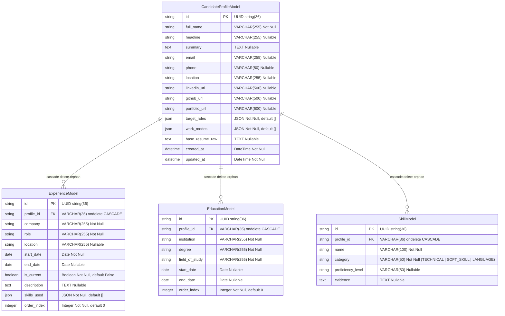

# Data Model: Candidate Profile & Base Resume Management (As-Built)

**Feature Branch**: `001-candidate-profile`  
**Date**: 2026-11-04  
**Status**: Implementado no Código

## Diagrama Entidade-Relacionamento Refletido do Código

O modelo reflete diretamente as classes ORM em [`backend/app/models/entities.py`](file:///C:/dev/projects/jobmatch-agent/backend/app/models/entities.py) e os esquemas Pydantic em [`backend/app/models/profile.py`](file:///C:/dev/projects/jobmatch-agent/backend/app/models/profile.py):

## Regras de Validação Verificadas em Código

1. **Validação Temporal (`ExperienceSchema.validate_dates`)**:
   - `start_date > end_date` lança `ValueError("end_date must be after start_date")`.
   - `is_current == True` acompanhado de `end_date` lança `ValueError("A current role cannot have an end_date")`.
2. **Obrigatoriedade e Tipagem**:
   - `full_name` obrigatório com `min_length=1`.
   - `WorkMode`: `REMOTE`, `HYBRID`, `ON_SITE`.
   - `SkillCategory`: `TECHNICAL`, `SOFT_SKILL`, `LANGUAGE`.
3. **Persistência Relacional**:
   - Chave estrangeira com `ondelete="CASCADE"` e relacionamento SQLAlchemy com `cascade="all, delete-orphan"`, garantindo que exclusões do perfil excluam todas as entidades associadas.
