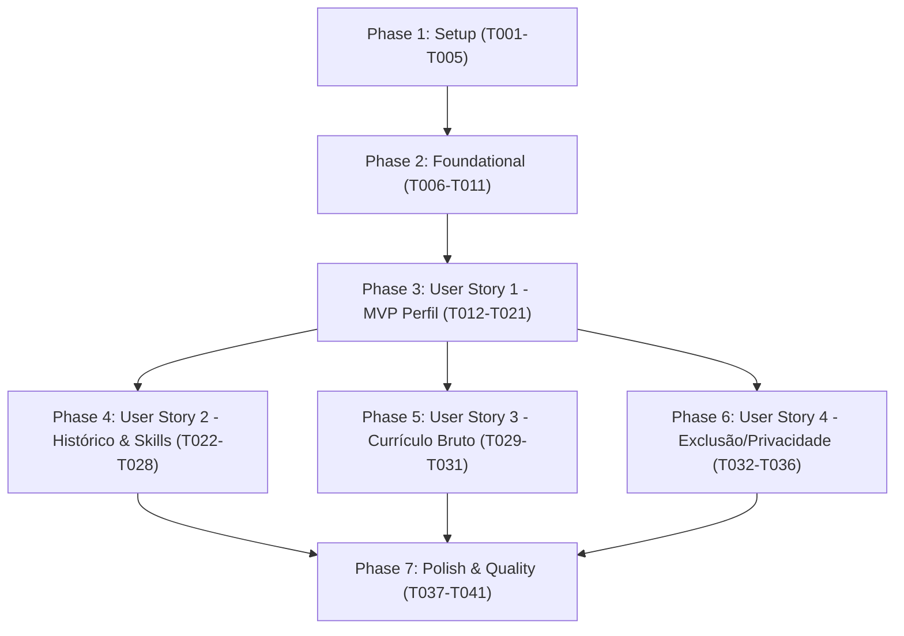

# Tasks: Candidate Profile & Base Resume Management

**Input**: Design documents from `/specs/001-candidate-profile/` (`spec.md`, `plan.md`, `research.md`, `data-model.md`, `contracts/profile-api.yaml`, `quickstart.md`)  
**Prerequisites**: plan.md (concluído), spec.md (concluído), research.md (concluído), data-model.md (concluído), contracts/ (concluído)  
**Tests**: Testes automatizados incluídos conforme TDD e diretrizes do `AGENTS.md` (Pytest para backend, Vitest + RTL para frontend).  
**Status**: Todas as tarefas representam o ciclo de implementação executado e validado em conformidade com o código-fonte atual.

## Format: `[ID] [P?] [Story] Description`

- **[P]**: Tarefa executável em paralelo (arquivos distintos, sem dependência bloqueante)
- **[Story]**: Mapeamento para história de usuário correspondente (`[US1]`, `[US2]`, `[US3]`, `[US4]`)
- Caminhos exatos para backend em `backend/` e frontend em `frontend/`

---

## Phase 1: Setup (Shared Infrastructure)

**Purpose**: Inicialização e estrutura compartilhada do projeto para backend e frontend

- [x] T001 Inicializar estrutura modular do repositório contendo diretórios `backend/` e `frontend/` conforme plano de implementação
- [x] T002 Configurar ambiente Python 3.11+ com dependências (`fastapi`, `sqlalchemy`, `pydantic`, `pytest`, `httpx`) em `backend/pyproject.toml` ou ambiente virtual
- [x] T003 [P] Configurar projeto Vite React 19 com TypeScript strict mode e Tailwind CSS v4 em `frontend/package.json`
- [x] T004 [P] Configurar tokens do Design System no arquivo de estilização global em `frontend/src/index.css`
- [x] T005 [P] Configurar ambiente de testes Vitest e React Testing Library em `frontend/src/tests/setup.ts`

---

## Phase 2: Foundational (Blocking Prerequisites)

**Purpose**: Infraestrutura de banco de dados, roteador base e componentes atômicos essenciais

- [x] T006 Configurar engine SQLAlchemy, fábrica de sessões e dependência de injeção `get_db` em `backend/app/core/database.py`
- [x] T007 [P] Implementar componente atômico `Button` com variantes do Design System e acessibilidade WCAG AA em `frontend/src/components/ui/Button.tsx`
- [x] T008 [P] Implementar componente atômico `Input` com suporte a estados de erro e `aria-describedby` em `frontend/src/components/ui/Input.tsx`
- [x] T009 [P] Implementar componentes atômicos `Badge` e `Card` para superfícies elevadas e status semânticos em `frontend/src/components/ui/Badge.tsx` e `frontend/src/components/ui/Card.tsx`
- [x] T010 [P] Criar testes unitários para componentes atômicos de UI em `frontend/src/tests/ui/Button.test.tsx`, `frontend/src/tests/ui/Input.test.tsx` e `frontend/src/tests/ui/BadgeAndCard.test.tsx`
- [x] T011 Configurar servidor FastAPI principal e middleware CORS em `backend/app/main.py`

**Checkpoint**: Fundação pronta - persistência e componentes base validados.

---

## Phase 3: User Story 1 - Cadastro e Manutenção do Perfil Profissional (Priority: P1) 🎯 MVP

**Goal**: Permitir cadastro, consulta e atualização de dados básicos do candidato, contatos, redes profissionais e cargos-alvo.

**Independent Test**: Pode ser testado salvando dados cadastrais via `PUT /api/v1/profile`, consultando via `GET /api/v1/profile` e preenchendo o formulário na interface visual com feedback imediato.

### Tests for User Story 1

- [x] T012 [P] [US1] Criar testes de validação de schemas de perfil (`CandidateProfileBase`, campos obrigatórios) em `backend/tests/unit/test_profile_schemas.py`
- [x] T013 [P] [US1] Criar testes de integração de repositório para criação e leitura de perfil em `backend/tests/integration/test_profile_repository.py`
- [x] T014 [P] [US1] Criar testes de contrato da API para `GET /api/v1/profile` e `PUT /api/v1/profile` em `backend/tests/api/test_profile_api.py`

### Implementation for User Story 1

- [x] T015 [P] [US1] Implementar modelo ORM `CandidateProfileModel` com campos cadastrais (`full_name`, `headline`, `summary`, `email`, `phone`, `location`, `linkedin_url`, `github_url`, `portfolio_url`, `target_roles`, `work_modes`) em `backend/app/models/entities.py`
- [x] T016 [P] [US1] Implementar schemas Pydantic `CandidateProfileBase`, `CandidateProfileCreate`, `CandidateProfileUpdate` e `CandidateProfileResponse` em `backend/app/models/profile.py`
- [x] T017 [US1] Implementar métodos `get_first_profile()`, `create_profile()` e `update_profile()` em `backend/app/repositories/profile_repository.py`
- [x] T018 [US1] Implementar endpoints `GET /api/v1/profile` e `PUT /api/v1/profile` em `backend/app/api/profile.py` e registrar no router da aplicação
- [x] T019 [P] [US1] Definir interfaces TypeScript estritas `CandidateProfile` e `WorkMode` em `frontend/src/types/profile.ts`
- [x] T020 [US1] Implementar funções de serviço `getProfile()` e `upsertProfile()` em `frontend/src/services/profileService.ts`
- [x] T021 [US1] Implementar seção de dados básicos, contato e objetivos na tela `frontend/src/sections/Profile/ProfileSection.tsx`

**Checkpoint**: User Story 1 totalmente funcional como MVP isolado.

---

## Phase 4: User Story 2 - Gestão Estruturada de Histórico e Competências (Priority: P1)

**Goal**: Adicionar entidades filhas (experiências, educação e competências/idiomas categorizados) com integridade temporal e relacional.

**Independent Test**: Testado adicionando itens nas listas dinâmicas de histórico profissional e competências, validando rejeição de `start_date > end_date` e persistência em cascata.

### Tests for User Story 2

- [x] T022 [P] [US2] Criar testes de validação temporal (`validate_dates`, bloqueio de `end_date` em cargo atual) em `backend/tests/unit/test_profile_schemas.py`
- [x] T023 [P] [US2] Criar testes de integração de repositório para sincronização atômica de experiências, formação e competências em `backend/tests/integration/test_profile_repository.py`

### Implementation for User Story 2

- [x] T024 [P] [US2] Implementar modelos ORM `ExperienceModel`, `EducationModel` e `SkillModel` com chaves estrangeiras `profile_id` e relacionamento em cascata em `backend/app/models/entities.py`
- [x] T025 [P] [US2] Implementar schemas Pydantic `ExperienceSchema`, `EducationSchema`, `SkillSchema` e enum `SkillCategory` em `backend/app/models/profile.py`
- [x] T026 [US2] Atualizar método `update_profile()` no repositório `backend/app/repositories/profile_repository.py` para sincronizar atômica e ordenadamente coleções filhas
- [x] T027 [P] [US2] Definir interfaces TypeScript `Experience`, `Education` e `Skill` em `frontend/src/types/profile.ts`
- [x] T028 [US2] Implementar blocos dinâmicos para adição, edição e remoção de experiências, cursos e competências em `frontend/src/sections/Profile/ProfileSection.tsx`

**Checkpoint**: Histórico profissional e competências 100% estruturados e consistentes com o perfil.

---

## Phase 5: User Story 3 - Preservação do Currículo-Base Bruto (Priority: P2)

**Goal**: Permitir colagem e armazenamento intacto do texto original de currículo em Markdown/texto no campo `base_resume_raw`.

**Independent Test**: Testado colando texto complexo em Markdown com quebras e links, gravando e confirmando integridade textual de 100% sem alterações.

### Tests for User Story 3

- [x] T029 [P] [US3] Criar testes de persistência do campo `base_resume_raw` com texto Markdown longo em `backend/tests/integration/test_profile_repository.py`

### Implementation for User Story 3

- [x] T030 [US3] Integrar campo `base_resume_raw` no modelo `CandidateProfileModel` e schemas `CandidateProfileCreate`/`CandidateProfileUpdate` em `backend/app/models/`
- [x] T031 [US3] Adicionar editor de texto Markdown com instruções de preservação na interface em `frontend/src/sections/Profile/ProfileSection.tsx`

**Checkpoint**: Currículo-base preservado na íntegra sem intervenção ou mutação automatizada.

---

## Phase 6: User Story 4 - Privacidade, Controle e Exclusão Total de Dados Locais (Priority: P3)

**Goal**: Fornecer exclusão definitiva e em cascata de todas as informações do perfil (atendendo ao RF-12 e governança de privacidade).

**Independent Test**: Testado executando `DELETE /api/v1/profile` e verificando status 204 com banco de dados limpo e resposta subsequente 404.

### Tests for User Story 4

- [x] T032 [P] [US4] Criar testes de API e repositório para exclusão em cascata em `backend/tests/api/test_profile_api.py`

### Implementation for User Story 4

- [x] T033 [US4] Implementar método `delete_profile()` com remoção em cascata no banco em `backend/app/repositories/profile_repository.py`
- [x] T034 [US4] Implementar endpoint `DELETE /api/v1/profile` retornando `status.HTTP_204_NO_CONTENT` em `backend/app/api/profile.py`
- [x] T035 [US4] Implementar função `deleteProfile()` no serviço de frontend `frontend/src/services/profileService.ts`
- [x] T036 [US4] Criar teste RTL simulando carregamento, edição e submissão na tela de perfil em `frontend/src/tests/sections/ProfileSection.test.tsx`

**Checkpoint**: Exclusão definitiva e controle soberano de dados implementados.

---

## Phase 7: Polish & Quality Assurance

**Purpose**: Validação contínua da tríade de qualidade e integridade do repositório

- [x] T037 [P] Executar suíte de testes de integração e unitários do backend via Pytest (`backend/tests/`)
- [x] T038 [P] Executar suíte de testes de componentes e telas do frontend via Vitest (`npm test -- --run`)
- [x] T039 Compilar frontend com `npm run build` garantindo verificação estrita de TypeScript (`tsc -b`) sem erros
- [x] T040 Validar conformidade de documentação OpenAPI em `specs/001-candidate-profile/contracts/profile-api.yaml`
- [x] T041 Validar cenários descritos no guia de execução em `specs/001-candidate-profile/quickstart.md`

---

## Dependencies & Execution Order

### Oportunidades Paralelas Executadas

- **Componentes Atômicos de UI:** `Button`, `Input`, `Badge` e `Card` foram desenvolvidos e testados em paralelo com seus respectivos testes em `frontend/src/tests/ui/`.
- **Modelos e Schemas:** A especificação de esquemas Pydantic no backend correu em paralelo com as interfaces estritas TypeScript no frontend.
- **Pipelines de Teste:** Pytest no backend e Vitest no frontend operam de forma 100% independente e paralela.

---

## Implementation Strategy & MVP Scope

1. **MVP (User Story 1):** Fornece cadastro e consulta funcional de identidade, contato e objetivos de carreira.
2. **Incremento 1 (User Story 2):** Estrutura o histórico cronológico de experiências e matriz de competências.
3. **Incremento 2 (User Story 3):** Assegura a integridade do currículo-base em texto original sem mutações.
4. **Incremento 3 (User Story 4):** Garante a conformidade de privacidade, retenção e exclusão definitiva de dados.
